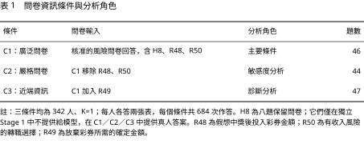
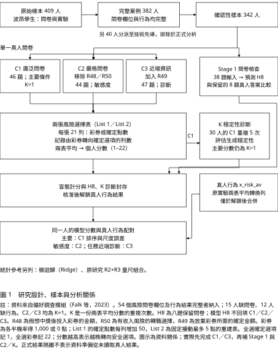
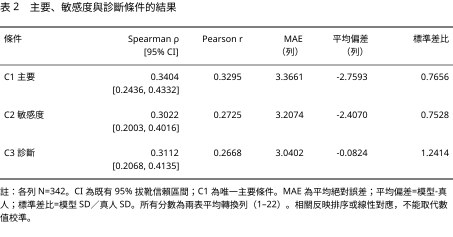
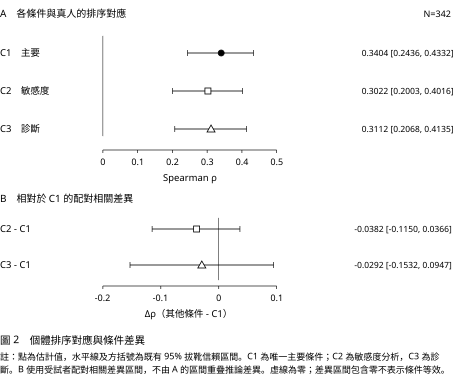
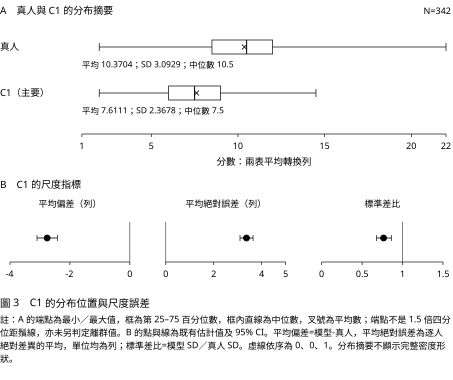

# 問卷條件化大型語言模型能否重建個體風險排序？排序對應、尺度偏差與測量穩定性

Can Questionnaire-Conditioned Large Language Models Recover Individual Risk Rankings? Rank Correspondence, Scale Bias, and Measurement Stability

楊世永（Yang Shih-Yung）

天主教輔仁大學金融與國際企業學系

## 中文摘要

大型語言模型能依人物資訊生成回答，但群體平均相似不代表能重建同一個人的行為。本研究使用偏好調查模組的複現資料，檢驗模型只接收個人問卷回答時，其風險選擇分數與真人行為的排序對應。409 筆原始資料中，382 位符合完整案例條件；排除事前分派至技術先導測試的 40 位後，確認性樣本為 342 位。主要條件 C1 提供 46 題問卷回答，每人完成兩張各 21 列的風險選擇表，平均轉換列形成一份測量，主要重複次數固定為 K=1。所有正式模型生成、計分與盲態診斷完成並封存後，才在正式分析階段解鎖真人結果。C1 與真人結果的 Spearman 相關為 0.3404，95% 信賴區間為 [0.2436, 0.4332]；平均絕對誤差為 3.3661 列，平均偏差為 −2.7593 列，標準差比為 0.7656。嚴格資訊條件 C2 與任務近端條件 C3 的相關分別為 0.3022 與 0.3112，與 C1 的差異區間均包含零。另以八題保留問卷進行檢查，逐題相關平均為 0.5308；30 人五次測量的單次組內相關為 0.8250。結果支持此固定樣本與任務中的部分個體排序對應，同時顯示分數偏低與變異壓縮。研究尚未證明模型重建個人心理機制，也不足以支持用模型分數替代真人行為量測。

關鍵詞：大型語言模型、風險偏好、問卷條件化、個體排序、尺度校準、確認性分析

## Abstract

Large language models can respond using person-specific information, but similarity in aggregate means does not establish correspondence with the same person's behavior. Using replication data from the Preference Survey Module, this study evaluates risk choices generated from individual questionnaire responses. Of 409 original records, 382 met the complete-case criteria; 40 were assigned to a technical pilot and excluded, leaving 342 confirmatory participants. The primary condition, C1, supplied 46 questionnaire answers. Each participant's score averaged switching rows from two 21-row choice lists, with one paired-list measurement (K=1) fixed in advance. Formal model generation, scoring, and outcome-blind diagnostics were sealed before the behavioral outcome was unlocked for confirmatory analysis. C1 scores correlated positively with human outcomes (Spearman rho=0.3404, 95% CI [0.2436, 0.4332]), but showed substantial absolute error (MAE=3.3661 rows), negative mean bias (−2.7593 rows), and compressed dispersion (SD ratio=0.7656). Correlations under the strict sensitivity condition C2 and the task-proximal diagnostic condition C3 were 0.3022 and 0.3112; their paired correlation-difference intervals included zero. A separate eight-item questionnaire check yielded a mean item-wise correlation of 0.5308. Five repeated measurements for 30 participants yielded a single-measure intraclass correlation of 0.8250. The findings support partial individual rank correspondence within this sample and task, alongside poor absolute calibration. They do not establish psychological mechanism recovery or validate replacing human behavioral measurements with model scores.

Keywords: large language models; risk preference; questionnaire conditioning; individual rankings; calibration; confirmatory analysis

## 一、前言

若以個人問卷回答設定大型語言模型（large language model, LLM）的作答觀點，模型能否生成與該人實際行為相符的選擇？這個問題不同於回答是否自然，也不同於一群模型的平均回答是否接近一群真人。對需要比較個體差異的研究而言，還必須問：模型是否能把同一批真人中風險承擔較高與較低的人大致排對，以及模型給出的分數是否落在合理尺度上。

已有研究使用人物資訊模擬調查或實驗反應，但對不同任務的表現並不一致（Aher et al., 2023；Argyle et al., 2023；Bisbee et al., 2024）。因此，本研究將研究問題限定為：**在正式生成與計分流程不能取得真人行為結果的條件下，個人風險問卷回答所條件化的 LLM 分數，與同一人的既有風險行為有多大的排序對應？**

本文以偏好調查模組（Preference Survey Module, PSM）的複現資料為基礎。主要貢獻是提供一個範圍明確的個體配對評估：固定資訊條件、事前計分規則與結果存取邊界，分別報告排序、尺度偏差與生成穩定性。這是一項既有真人資料上的模型驗證研究，沒有重新招募受試者，也沒有估計人物設定的因果效果。

## 二、文獻回顧

### 2.1 風險測量：共同特質、方法差異與行為效度

風險偏好可由自陳問卷、有報酬的選擇任務及生活行為衡量，但這些工具未必反映相同的個體差異。心理學綜述與多方法研究指出，自陳資料可呈現一般風險傾向，其與行為任務的對應卻偏弱；中文領域特異性研究則提醒，金錢、健康或社會情境中的風險決策可能具有不同意義。因此，本文的生活領域問卷與金錢彩券選擇雖可能共享資訊，仍須分別驗證，不能預設可互換（[Mata et al., 2018](https://doi.org/10.1257/jep.32.2.155)；[Frey et al., 2017](https://pmc.ncbi.nlm.nih.gov/articles/PMC5627985/)；[岳靈紫等，2018](https://journal.psych.ac.cn/xlkxjz/CN/abstract/abstract4292.shtml)）。

問卷仍可能包含可用的行為資訊。Dohmen et al.（[2011](https://doi.org/10.1111/j.1542-4774.2011.01015.x)）以有實際報酬的彩券選擇驗證一般風險自陳題；Falk et al.（[2023](https://doi.org/10.1287/mnsc.2022.4455)）進一步以實驗行為驗證偏好調查模組，構成本研究的資料基礎。Bittner et al.（[2024](https://doi.org/10.1016/j.econlet.2024.111851)）在中國、美國及德國樣本重新驗證相關風險工具，也發現定量與定性題目的組合有助樣本外預測。這條研究脈絡支持使用問卷作為資訊來源，但問卷本身的效度不會自動延伸到接收回答的 LLM；其生成分數仍須與同一人的行為配對檢查。此處存在兩道不同的推論：問卷是否反映真人的風險傾向，以及模型能否利用這些資訊生成相應行為。前一道推論有文獻支持，仍不能省略後一道驗證；這正是本文把模型生成視為一份新測量的理由。

行為效度也不能由重測穩定性替代。Lönnqvist et al.（[2015](https://doi.org/10.1016/j.jebo.2015.08.003)）發現風險問卷與彩券任務對應偏弱，且問卷的一年重測較穩定；Bagaïni et al.（[2025](https://www.nature.com/articles/s41562-024-02085-2)）的統合分析進一步顯示，時間穩定性與跨方法收斂效度均依工具而異。前者問同一測量能否維持個體差異，後者問不同測量是否指向相近構念。本文因此將保留問卷的預測、模型重複生成的穩定性，以及真人行為對應分開評估。有誘因的任務提供特定決策情境中的行為效標，並非所有風險傾向的唯一標準；問卷與任務關係較弱，也不必然表示其中一種完全無效。較合理的問題是：在明確工具與情境下，哪些資訊可以跨方法保留，哪些差異仍需另外解釋。

臺灣研究提供測量比較與市場行為兩種補充脈絡。陳麗宇（[2003](https://ndltd.ncl.edu.tw/handle/01791204455083727785)）使用美國消費者財務調查，比較作者所稱的主觀與客觀風險承受度；陳國蒓（[2019](https://ah.lib.nccu.edu.tw/item?item_id=141119)）使用臺灣文官調查，指出兩組風險量表整體一致之下，部分受試者的評價仍有差異。此處僅依兩篇官方摘要引用測量比較，未據以推論未核讀的誘因設計或指標建構。它們共同提醒：整體一致仍須配合個體層次檢查。對本文而言，即使兩組分數的平均或分布相近，也可能把不同的人排在相似位置；保留同一人的配對，才能區分群體輪廓與個體對應。

在市場研究中，王韻怡等（[2016](https://doi.org/10.6277/TER.2016.441.1)）整理臺灣行為財務文獻，討論交易紀錄提供的行為證據及其心理解釋界線；王明昌等（[Wang et al., 2016](https://ibm.nycu.edu.tw/ibm/cmr/2016_Issue1/Corporate%20Management%20Review_2016%20Volume%2036%2C%20issue%201%2C%2069-96.pdf)）則以信用交易帳戶及交易頻率、經驗等特徵研究風險決策。真實交易代理變數與獨立問卷或實驗分數是不同的操作化方式，不能視為同尺度證據。這些臺灣研究與上述中國大陸中文綜述補充測量脈絡，但不使本文德國樣本的結果自然適用於臺灣人口。

這些測量研究亦界定了本文的研究問題：模型是否能將已知問卷中的個體差異，轉為與真人行為相關的選擇分數？此問題同時需要正向與限制證據。問卷經驗證的行為資訊使嘗試具有依據；跨方法差異則提醒，即使模型掌握問卷內容，行為預測仍可能受限。本文據此檢驗特定任務中的對應程度，而非假定存在一個所有工具皆能完整還原的風險偏好真值。

### 2.2 從群體模擬到同一人的行為驗證

LLM 能否模擬人類，取決於驗證對象與層次。Aher et al.（[2023](https://proceedings.mlr.press/v202/aher23a.html)）與 Argyle et al.（[2023](https://doi.org/10.1017/pan.2023.2)）分別展示經典實驗規律及背景條件化調查反應的模擬潛力，但群體規律不直接保證個體配對成立。Lin（[2026](https://doi.org/10.1177/25152459251410153)）區分人物模擬與認知歷程建模，強調具真人基準時應檢查任務可比性與反應分布。本文所稱人物設定，是以一位已知真人的回答設定模型；評估重點是生成行為是否對應同一人，而非回答自然或角色一致。群體模擬主要檢查某種規律能否出現，個體模擬則要求生成差異與特定真人連結。模型若只重現常見回答或群體刻板印象，仍可能呈現合理的整體結果，卻不足以支持個人層次的使用。

更接近此目標的是以個人資料建立代理，再驗證保留反應的研究。Park et al.（[2026，v3 預印本](https://arxiv.org/abs/2411.10109v3)）使用訪談、結構式問卷或兩者模擬個人；鄔佳宏（[2025](https://ndltd.ncl.edu.tw/cgi-bin/gs32/gsweb.cgi/login?o=dnclcdr&s=id%3D%22113FJU00506006%22.&searchmode=basic)）的臺灣碩論公開摘要則描述結合試題反應理論與生成式 AI 模擬考生，再依能力與反應相似度進行人機配對。兩者顯示個體驗證的重要性，也凸顯設計差異：本文預先固定真人對應關係，僅提供問卷回答，再檢查另一類行為；不同資訊量、配對程序及指標的效應量不宜直接比較。問卷條件化的優點是輸入資訊較容易界定與追蹤；相對地，既有題目未必涵蓋影響新決策的全部因素。因此，本文將推論限定在已提供資訊與指定任務的對應，而不把一組風險分數視為完整的數位分身。

問卷相似能否延伸至行為，是其中的關鍵缺口。Chang（[2026](../provenance/unbundled_reference.md)）的臺灣國科會學生研究成果報告，以反推的隱含問卷向量設定模型，指出可辨識的問卷差異未必轉成最後通牒遊戲中的行為差異。這份非同儕審查報告提供區分兩種效度的例子；本文則使用真人原始問卷與預先配對的行為結果，直接檢驗此一跨任務對應。

保留問卷與行為效標在此扮演不同角色。前者檢查模型能否利用已提供回答推測未提供的同類題目，後者檢查此能力能否延伸至不同形式的決策。因此，良好的保留題表現可支持條件化資訊具有可辨識性，卻不能當作行為驗證已完成；兩者的落差本身也具有研究意義。

### 2.3 排序、尺度與穩定性的分層驗證

即使群體平均接近真人，合成回答仍可能壓縮變異、改變變數關係，或對提示與模型版本敏感（[Bisbee et al., 2024](https://doi.org/10.1017/pan.2024.5)；[Tjuatja et al., 2024](https://doi.org/10.1162/tacl_a_00685)）。因此，平均相似不足以代表個體差異重現，正向相關也不足以代表數值校準。本文同時報告個體排序、平均偏差、絕對誤差與標準差比，以區分「大致排對人」和「分數接近真人」；另以重複生成檢查同一設定下的測量穩定性。例如，所有人的分數同時偏低，仍可能保留排序；分數集中於平均附近，也可能降低部分點預測誤差，卻失去跨人差異。這些是不同的評估目標，不能用單一準確率合併判斷。

驗證還須交代資訊與可重現性的邊界。Ludwig et al.（[2026](https://doi.org/10.1146/annurev-economics-120925-105620)）區分 LLM 的預測與測量用途，並強調驗證資料及訓練洩漏問題。本文的結果鎖定限制生成流程取得目標答案，但無法排除公開原始資料曾進入模型訓練集；封存提示、設定與輸出，亦不等於未來雲端模型必然生成相同答案。對既有輸出重新計分與分析，以及重新呼叫模型取得新答案，因而是兩種不同的可重現性要求；保存前者的證據，仍須交代後者受服務端變動影響的限制。

綜合而言，本文建立三層互補證據：保留問卷檢查條件化資訊是否可用，重複生成檢查測量是否穩定，真人配對則檢查行為排序與尺度是否相符。研究貢獻在於固定資訊條件下的個體行為驗證；即使其中一層表現良好，也不能替代其他層次，更不能單憑行為對應宣稱重建個人的心理機制。

## 三、研究方法

### 3.1 資料來源、樣本與結果鎖定

原始來源為 PSM 複現套件的 `MainSample_Replication.dta`，共有 409 筆個人紀錄、195 個欄位。原作者於 2010／2011 年冬季在波昂大學蒐集實驗與問卷資料。本文要求 54 個已釋出的風險相關欄位及目標行為結果均完整：15 位缺問卷欄位，另 12 位缺結果，兩者不重疊，保留 382 位。使用 PCG64 隨機產生器與固定種子 20260902，分派 40 位至技術先導測試（Pilot），其餘 342 位為確認性樣本（Confirmatory）；沒有按結果分層。先導測試原排定 420 項工作，完成 13 項後於第 14 項進入模型對話前失敗，其餘停止，所有先導資料均排除於正式統計。

真人目標 `x_risk_av` 是複現資料已提供的兩張實驗風險選擇表之平均轉換列，範圍為 1 至 22；越晚由風險選項轉向安全選項，分數越高。它是既有行為彙總值，不是模型生成答案，也不是直接估計的效用函數參數。釋出資料不含每人原始 42 列選擇，故本文無法驗證逐列的人機一致率。

結果鎖定（outcome lock）指正式生成器不能取得 `x_risk_av`、完整資料檔或其他人的資料；正式分析先封存不使用目標結果的計分、問卷檢查與重複穩定性產物，再讀取鎖定結果合併。資料準備曾為建立完整案例及鎖定檔而讀取結果，前期本機測試的存取事件也留有紀錄；因此，本文不宣稱整個專案從未接觸結果。研究設計與修訂有內部版本及核准紀錄，本文亦不將其稱為公開平台上的外部預註冊。

### 3.2 問卷條件與生成設定

問卷條件化是把單一真人的核准題目與實際答案提供給模型，要求模型從該人的觀點回答新問題；沒有以這批受試者訓練模型權重。R 加數字是原問卷題號，C 加數字是本文的資訊條件，兩者並非同一種編碼。

<!-- JOURNAL_TABLE_BEGIN -->

<!-- JOURNAL_TABLE_END -->

R48 是假想中獎後願投入風險彩券的金額類別；R50 是面對收入可能增加或減少時是否願意轉職的二元回答。R49 詢問受試者需要多少確定金額才願放棄一張以各半機率支付 €1,000 或 €0 的彩券，因此與目標任務特別接近。C3 以此檢查額外近端資訊伴隨的分數變化，不能取代 C1。

三個條件均排除 R1、R2，以及五個無法取得完整原題文字的已釋出欄位（`v_115`、`v_116`、`v_127`、`v_132`、`v_141`）。R50 的題幹有原附錄支持，但 `v_108` 的「1=願意、2=不願意」來自同類來源的交叉核對，並非 PSM 檔案直接提供的值標籤。模型看到文字選項，並不消除這項對照不確定性。

模型固定為 `gpt-5.6-terra`，推理設定為 `medium`、速度 `standard`、快速模式關閉；透過 ChatGPT 認證執行，未使用付費 API。溫度由平台管理，研究者無法自行固定。每項工作使用新的對話與工作空間，僅提供當前一人的核准答案，禁止對外查詢，識別鍵不寫入提示。生成紀錄中，工具版本 0.153.0 涵蓋 424 項正式工作，0.153.3 涵蓋 2,210 項；科學設定維持不變，但沒有隨機化比較可用來排除版本或服務端變化的影響。

### 3.3 獨立保留題檢查：Stage 1 與 H8

Stage 1 是「問卷條件化檢查」的名稱，不代表實際先於所有行為生成。H8 是事前固定的八題保留題組：R3、R6、R8、R12、R13、R17、R24、R41，涵蓋一般及多個領域的風險態度。每人提供 C1 中其餘 38 題，請模型回答 H8 的 0–10 分答案，再逐題與該題真人答案比較。

這 342 項檢查實際於原 C1／C3 行為生成完成後獨立補做，仍在正式結果分析解鎖前完成。C1／C2／C3 行為任務使用真人 H8 答案；Stage 1 的預測沒有回填、篩選或改變既有行為生成。故本文不能把 Stage 1 畫成建立人物設定後再把預測送往行為任務的串接流程。

Benchmark-0 是問卷檢查中的簡單算術參考，不是另一個 LLM，也不是「沒有提供人物資訊」的模型條件。它從 38 題輸入中排除 R29、R35、R48、R50，將剩餘 34 題依既定方向對齊後平均：程式先除以 10 轉為 0–1，反向題以 1 減去該值，再取平均乘以 10，回到 0–10。每個人的同一參考分數分別與八題真人答案計算相關；另報告其與真人八題平均的相關。這兩種聚合方式不可混用。

### 3.4 兩張風險選擇表與計分

List 1 與 List 2 是兩張不同金額排程的選擇表，每張均有 21 列。每列在固定風險選項（各半機率得到 1,000 點或 0 點）與一個確定金額間二選一。List 1 的確定金額由 0 至 1,000，每列增加 50。List 2 固定兩個端點，將中間 19 個金額以種子 20260903 分別加入 −5 至 +5 的整數擾動。它是依原研究規則重建的固定排程，不是受試者當年實際看到的未知擾動向量。模型也沒有承擔真人實驗中的實際金錢得失。

計分只使用所選選項。對每張表，若選擇由 LOTTERY（風險選項）轉為 SAFE（確定選項），以轉入 SAFE 的列號計分，列號從 1 起算；多次轉換時取這些列號的平均。全選 SAFE 記 1，全選 LOTTERY 記 22，這兩項是研究者事前核准的邊界規則。混合選擇卻沒有 LOTTERY→SAFE 轉換時記為缺值。兩張表都得到有效分數才形成個人分數。

令 \(i\) 表示受試者、\(c\) 表示 C1／C2／C3、\(\ell\) 表示第 1 或第 2 張表、\(r\) 表示重複測量次序；\(s_{ic\ell r}\) 為上述單表轉換分數。一份兩表測量為：

\[
A_{icr}=\frac{s_{ic1r}+s_{ic2r}}{2},\qquad X_{ic}=A_{ic1}.
\]

\(A_{icr}\) 回答同一人同一次的綜合風險分數是多少；\(X_{ic}\) 是主要分析使用的第一次兩表測量。K 代表每人兩表測量的重複次數，主要 K=1，故兩張表不等於 K=2。分數越高表示越晚轉向確定選項；分數差的單位是轉換列，不是金額或心理特質的等距單位。

### 3.5 重複穩定性與實際流程

主要 K=1 在正式結果存取前固定。另以種子 20260904 選定 30 位確認性受試者，保留原 C1 第一次測量，再各增加第 2–5 次兩表測量，合計 240 項新增工作。這些輸出只評估同一設定的穩定性，不參與主要分數平均，也不據以挑選 K。

使用單因子隨機效果、單次測量的組內相關係數 ICC(1,1)。其意義是人際差異相對於人際差異及重複誤差總和的比例；採用此模型時，將各次測量視為同一設定下可交換的重複，不另估計共通次序或平台漂移效果。模型種類、單次或平均測量及區間都應明列，不能只用一個門檻宣告量尺已驗證（Koo & Li, 2016）。[Koo 與 Li（2016）](https://doi.org/10.1016/j.jcm.2016.02.012)

以 \(q\) 表示估計的單次 ICC，\(m\) 表示假設平均的測量次數，報告中的平均信度換算為：

\[
q_m=\frac{m q}{1+(m-1)q}.
\]

此式回答在相同變異結構、可交換重複與誤差不相關假設下，平均多次測量的預期信度。m=3、5 的數字是由同一組變異成分換算，不是另外驗證三次或五次平均對真人結果的預測效度。

實際研究順序為：原始資料與完整案例建立 → 先導／確認性分派 → 固定問卷與行為規則 → C1／C3 原始行為生成 → 獨立 Stage 1 補充 → 已另行核准的 C2 與 K 補充生成 → 全部生成封存 → 不使用目標結果的計分、H8 與 K 診斷封存 → 正式結果解鎖 → 主要分析、敏感度分析與統計參考 → 事後尺度說明 → 論文。

正式生成合計 2,634 項：C1／C3 共 1,368、Stage 1 共 342、C2 共 684、K 診斷新增 240。執行嘗試共 2,650 次；技術中斷與重試不被當成新增觀測。重試政策與成功紀錄保留於方法材料，未依行為結果挑選重跑。

<!-- JOURNAL_FIGURE_BEGIN -->

<!-- JOURNAL_FIGURE_END -->

### 3.6 主要推論與補充指標

主要評估量為 C1 分數與真人結果的 Spearman 等級相關（排序相關）。令 \(Y_i\) 為第 i 人的 `x_risk_av`，\(X_i=X_{i,C1}\)，\(R(\cdot)\) 為在樣本內取排名、同分採平均名次的運算，\(\operatorname{corr}\) 為 Pearson 相關，則：

\[
\rho_s=\operatorname{corr}\{R(X),R(Y)\}.
\]

這個量回答模型與真人是否有相似的高低排序，不是答對率。95% 信賴區間採 10,000 次以受試者為單位的拔靴重抽樣（bootstrap）百分位區間；同一人的模型分數與真人結果一起重抽。主要檢定以 10,000 次打亂真人與模型配對的雙尾置換計算，隨機種子分別為 20260911、20260912。若 \(b\) 是絕對相關不小於觀察值的置換次數，\(B=10{,}000\) 為總置換次數，則 \(p=(b+1)/(B+1)\)。這項加一修正使有限隨機置換的 p 值不會被錯報為零（Phipson & Smyth, 2010）。[Phipson 與 Smyth（2010）](https://doi.org/10.2202/1544-6115.1585)

為檢查絕對尺度，另報告平均絕對誤差（MAE）、有正負號的平均偏差及標準差比：

\[
\mathrm{MAE}=\frac1n\sum_{i=1}^{n}|X_i-Y_i|,\qquad
\mathrm{bias}=\frac1n\sum_{i=1}^{n}(X_i-Y_i),\qquad
\mathrm{SD\ ratio}=\frac{s_X}{s_Y}.
\]

\(n\) 是有效配對人數，主分析為 342；\(s_X\)、\(s_Y\) 是分別以 n−1 為分母的樣本標準差。MAE 是平均相差多少列；負 bias 表示模型分數平均偏低；標準差比小於 1 表示模型跨人的分散程度較小。這些量可以描述操作量尺上的校準，不能當作潛在風險偏好的誤差大小。Pearson 相關則補充描述原始分數的線性對應。

C2／C3 與 C1 的相關差異採配對受試者拔靴區間；絕對誤差差異採相同配對重抽與受試者內標籤交換、雙尾加一修正檢定。這項交換檢定有配對差異對稱／可交換的假設，並非隨機分派人物資訊的因果實驗。差異區間包含零表示估計尚不精確，不能用來證明條件等效。Stage 1 的整體指標是八個逐題相關的平均，置換時保留每人的完整八題向量；單題推論另有 Holm 多重比較調整。K 區間也以完整受試者重複向量重抽。C1 是唯一主要推論，其餘分析維持各自的次要或診斷角色。

### 3.7 統計參考與事後尺度描述

Ridge（嶺迴歸）是一種限制係數大小的監督式預測方法。本文使用 C1 的 46 個數值特徵，以外層五折產生每人的折外預測；每次只在其餘四折內，以內層五折的均方誤差選擇懲罰強度。標準化只在相應訓練折估計，33 個候選強度由 \(10^{-4}\) 至 \(10^4\) 對數等距排列。如此避免用受評估人的結果挑選模型，但不表示它與不接收此樣本行為結果的 LLM 資訊相等。模型选擇與評估分離的必要性可見 Cawley 與 Talbot（2010）。[Cawley 與 Talbot（2010）](https://jmlr.org/papers/v11/cawley10a.html)

R2+R3 是原研究提出的兩題風險測量組合，用於背景參考。R3 是 0–10 分的一般風險意願；R2 是假想的 31 列彩券與確定金額選擇，釋出檔以單一數值 `v_109` 儲存，其逐列壓縮規則未完整說明。本文沿用原複現公式，而不自行還原未釋出的答案：

\[
Z_i=0.4244\,z(R3_i)+0.5756\,z(R2_i),\qquad
z(V_i)=\frac{V_i-\bar V}{s_V}.
\]

\(Z_i\) 是第 i 人的組合分數；\(V\) 表示被標準化的變數，\(\bar V\) 與 \(s_V\) 分別為本文 342 人的平均及樣本標準差。R2+R3 的 MAE 是對同樣標準化後的真人結果計算，不能與其他方法以「列」計算的 MAE 直接比較。其選題與權重來自同一原始研究資料脈絡，本文確認性子樣本並非該已發表量尺的獨立外部測試集。

文中報告的 \(R^2=1-\sum_i(Y_i-\widehat Y_i)^2/\sum_i(Y_i-\bar Y)^2\) 比較指定預測 \(\widehat Y_i\) 與真人結果均值 \(\bar Y\) 的平方誤差；Ridge 使用原始尺度，R2+R3 則將式中的真人結果與預測替換成標準化結果及 \(Z_i\)。負值表示在該指定尺度上的平方誤差比用結果均值更大，並不排除正向排序相關。

另有在結果解鎖後加入的常數中位數描述：對同一樣本所有人都預測其真人中位數，以說明誤差尺度。這是同樣本事後描述，沒有折外驗證、個體排序能力或新增主要檢定；不能稱為事前確認性基準。

## 四、分析結果

### 4.1 主要排序與尺度結果

342 人的 C1 分數與真人結果呈正向排序相關，\(\rho_s=0.3404\)，95% 區間 [0.2436, 0.4332]，雙尾置換 p=0.00009999。這是 10,000 次加一修正置換可達的最小 p 值，而非精確到八位小數的連續機率。相關表示有限的人際排序對應，不能解讀為「34% 準確率」，也不能把其平方當成本研究已驗證的解釋變異比例。

<!-- JOURNAL_TABLE_BEGIN -->

<!-- JOURNAL_TABLE_END -->

真人分數平均為 10.3704、標準差 3.0929；C1 平均為 7.6111、標準差 2.3678，中位數 7.5、範圍 2 至 14.5。C1 偏向較早切換至確定選項，且壓縮人際分散程度。排序相關與這些校準落差同時存在。

事後常數中位數取值 10.5，MAE 為 2.3004 列；C1 的 MAE 為其 1.4633 倍。這顯示未經校準的 C1 逐人點分數有實際誤差限制。常數利用了同樣本結果，且對所有人的預測都相同，無法提供個體排名，不能據此取消主要排序發現。

<!-- JOURNAL_FIGURE_BEGIN -->

<!-- JOURNAL_FIGURE_END -->

<!-- JOURNAL_FIGURE_BEGIN -->

<!-- JOURNAL_FIGURE_END -->

### 4.2 C2 與 C3 的配對比較

C2−C1 的相關差為 −0.0382，95% 區間 [−0.1150, 0.0366]；絕對誤差差為 −0.1586 列，區間 [−0.3224, 0.0029]，p=0.061394。兩個差異的區間均包含零。移除 R48／R50 後仍有正向相關，但目前精確度不足以判斷這兩題是否產生具有實質重要性的影響，也不能宣稱等效或分辨兩題各自的貢獻。

C3−C1 的相關差為 −0.0292，95% 區間 [−0.1532, 0.0947]；依原分析固定方向，C1−C3 的絕對誤差差為 0.3259 列，區間 [−0.0225, 0.6780]，p=0.069693。C3 的平均偏差點估計較接近零，但標準差比大於 1，相關點估計也未高於 C1。這不是已確認的校準改善或較優方法；同樣本平均接近真人，更不代表每個人都預測得準。

### 4.3 問卷檢查與重複穩定性

Stage 1 的八題逐題 Spearman 平均為 0.5308，整體向量置換 p=0.00009999；單題由 R12 的 0.4036 至 R3 的 0.7556。Benchmark-0 的八題逐題相關平均為 0.3647，與「每人真人八題平均」的相關則為 0.6897。前者才與 Stage 1 的逐題平均採相同聚合層次；本文沒有新增模型相對該基準之差異檢定。

K 診斷中，30 人各五份兩表測量的 ICC(1,1) 為 0.8250，95% 區間 [0.6960, 0.8751]。由同一變異成分換算的三次、五次平均信度分別為 0.9340 與 0.9593。每人重複分數的標準差平均為 0.8246，而完整兩表選擇序列的重複配對完全一致率只有 0.3000。這表示分數相對穩定不等於逐列輸出完全相同，也不構成事後選擇 K=1 的理由。

C1、C2、C3 的兩表相關分別為 0.7915、0.7848、0.8673，平均絕對表間差分別為 1.3099、1.1959、0.9035 列。三條件均沒有多重轉換，選擇序列單調率為 1；被優勢選項支配的選擇比例介於 0 與 0.0058。這些任務內一致性診斷不能取代與真人比較的效度指標。

### 4.4 統計參考

Ridge 的折外 Spearman 相關為 0.2948，MAE 為 2.2170 列，\(R^2=0.0662\)；預測平均 10.3712、標準差僅 0.8785。其較小的點預測誤差伴隨明顯收縮，並未保留真人完整的分散程度。本文未針對其與 C1 的表現差異新增檢定，也不把不同資訊條件解讀為勝負。

R2+R3 的 Spearman 相關為 0.4319，Pearson 相關為 0.3791；標準化結果尺度的 MAE 為 0.7571，\(R^2=-0.0763\)。較高的相關點估計與負 \(R^2\) 不矛盾，且其 MAE 與上表單位不同。由於來源樣本與既有選題的關係，此結果提供風險量尺背景，不能充當本研究外部測試的上限或公平競賽基準。

另一份真人實驗重測資料的 44 人 Pearson 相關為 0.5890。該樣本、測量間隔及統計量都不同；本文沒有將其當作 C1 的理論上限，也沒有據以進行相關衰減校正。

## 五、討論與建議

### 5.1 可以支持的結論

本研究的主要證據是：在固定樣本、問卷條件與風險任務下，C1 產生的分數與同一真人有正向但有限的排序對應。獨立問卷檢查與重複診斷補充說明，模型能推測部分保留答案，其兩表分數在同一設定下也有一定穩定性。這些結果與「模型保留某些有助排序的資訊」相容，但沒有識別資訊如何作用，也沒有驗證完整人物或心理機制。

尺度結果是研究結論的一部分，而非需要淡化的附帶現象。C1 分數偏低、變異壓縮，且同樣本事後常數描述的 MAE 更小。這說明有排序訊號仍不足以把模型分數當成已校準的個人行為量尺。此處的分布問題與合成調查文獻關切相呼應，但不同模型、樣本與任務的結果不能互相當作直接重現。

分布與預測用途也須區分。若目的是生成可替代真人樣本的資料，跨人變異被壓縮便無法完整呈現異質性；若目的是降低個體點預測誤差，較集中的預測本身不足以判定失敗。因此，Ridge 的誤差與分散程度應分別解讀，不以是否重現真人標準差作為單一勝負標準。同樣地，本研究 K 診斷描述的是固定設定下的生成穩定性，並非重新觀察真人風險態度的時間穩定性；它不能補足跨方法行為效度，也不能用來推定本研究相關的理論上限。

### 5.2 識別與外部效度限制

第一，本研究沒有無人物設定的 LLM 對照，也沒有錯配人物問卷的消融比較。Benchmark-0 是算術問卷參考，不能補上此缺口。因此，本文沒有直接估計加入個人問卷相較於未加入時的增量效果，不能把觀察到的相關全數歸因於人物設定。

第二，原始樣本是單一地區的大學生，完整案例條件又排除了 27 人。確認性隨機分派能劃開先導資料，不能消除原始取樣與完整案例篩選的外部效度限制；結果不能直接推廣至臺灣、一般成人、其他語言或商業決策場景。

第三，真人結果只有平均轉換列，第二張模型選擇表是規則重建，且人機報酬動機不同。本文測的是彙總操作量尺上的對應，不是逐列實驗重演，也不是效用或機率加權參數的估計。問卷對照中的 R50 仍有跨來源編碼不確定性；同時移除 R48／R50 的 C2 不能單獨驗證任一題的正確性。

第四，K 診斷只有 30 人，ICC 區間仍有寬度；相同設定下的重複不代表模型更新後的可移植性。雲端溫度及服務端版本不能完全鎖定，工具版本也曾變動。完整輸出封存可支持對既有證據的重算，無法保證日後重新生成相同答案。

第五，結果存取隔離不等於訓練資料隔離。公開資料、原題或研究程式是否曾進入模型訓練集，本文無法確認。也不能把內部研究凍結說成已完成外部預註冊。

第六，C2／C3 差異未達明確證據，不等於無差異；本研究沒有事前等效界值。Ridge、R2+R3 與常數參考各有不同的監督、來源與尺度條件，無法將它們合併排名後宣稱某種方法普遍較好。

### 5.3 可重現性與後續用途

本研究保留題目對照、兩表排程、固定提示、生成設定、重試政策、計分與分析程式，以及彙總結果。歷史證據的獨立驗證入口已能核對封存引用與必要受限輸入雜湊，但尚未完成全新環境中的完整獨立統計重現。原分析工作區不能被當作可安全直接重跑的發行包。

逐人問卷、行為結果、含逐人連結的模型回答與識別鍵仍由受限材料管理；第三方來源的再散布權利也需另外確認。獨立公開套件提供方法、彙總產物及移除原始識別與逐人連結的結構化模型回答，見 [GitHub](https://github.com/sheyung21-crypto/llm-risk-behavior-study)。公開回答可核對單表計分，但不能單獨重現與真人 outcome 的配對分析；內部研究庫不原樣公開。公開材料、核准條件下的受限重現，以及重新呼叫雲端模型，應分別說明其能完成的工作。

對應用而言，本研究支持把此固定設定的 LLM 分數視為待驗證的排序訊號，而非個人風險評估工具。未來若要識別人物資訊的增量價值或評估跨樣本推廣，應另立研究與事前設計；不能在已見結果後更換目前的提示、條件、K 或主指標。現階段的出版工作應優先使讀者看清研究流程、資訊邊界、誤差單位與不確定性，並維持主要結果與負向結果並列。

## 參考文獻

王韻怡、池祥萱、周冠男（2016）。行為財務學文獻回顧與展望：台灣市場之研究。*經濟論文叢刊，44*（1），1–55。[DOI](https://doi.org/10.6277/TER.2016.441.1)

岳靈紫、李紓、梁竹苑（2018）。風險決策中的領域特異性。*心理科學進展，26*（5），928–938。[期刊原文](https://journal.psych.ac.cn/xlkxjz/CN/abstract/abstract4292.shtml)

陳國蒓（2019）。*不同量表，不同結果？探索兩組使用頻率最高的風險偏好量表*〔碩士論文，國立政治大學〕。政大學術集成。[官方摘要與書目](https://ah.lib.nccu.edu.tw/item?item_id=141119)

陳麗宇（2003）。*風險承受度與資產配置之研究*〔碩士論文，國立彰化師範大學〕。臺灣博碩士論文知識加值系統。[官方摘要與書目](https://ndltd.ncl.edu.tw/handle/01791204455083727785)

鄔佳宏（2025）。*結合試題反應理論與生成式AI於受試者答題行為模擬之研究*〔碩士論文，輔仁大學〕。臺灣博碩士論文知識加值系統。[公開摘要與書目](https://ndltd.ncl.edu.tw/cgi-bin/gs32/gsweb.cgi/login?o=dnclcdr&s=id%3D%22113FJU00506006%22.&searchmode=basic)

Aher, G. V., Arriaga, R. I., & Kalai, A. T. (2023). Using large language models to simulate multiple humans and replicate human subject studies. In A. Krause, E. Brunskill, K. Cho, B. Engelhardt, S. Sabato, & J. Scarlett (Eds.), *Proceedings of the 40th International Conference on Machine Learning* (Vol. 202, pp. 337–371). PMLR. [正式會議版本](https://proceedings.mlr.press/v202/aher23a.html)

Argyle, L. P., Busby, E. C., Fulda, N., Gubler, J. R., Rytting, C., & Wingate, D. (2023). Out of one, many: Using language models to simulate human samples. *Political Analysis, 31*(3), 337–351. [DOI](https://doi.org/10.1017/pan.2023.2)

Bagaïni, A., Liu, Y., Kapoor, M., Son, G., Bürkner, P.-C., Tisdall, L., & Mata, R. (2025). A systematic review and meta-analyses of the temporal stability and convergent validity of risk preference measures. *Nature Human Behaviour, 9*(4), 700–712. [期刊原文](https://www.nature.com/articles/s41562-024-02085-2)

Bisbee, J., Clinton, J. D., Dorff, C., Kenkel, B., & Larson, J. M. (2024). Synthetic replacements for human survey data? The perils of large language models. *Political Analysis, 32*(4), 401–416. [DOI](https://doi.org/10.1017/pan.2024.5)

Bittner, A., Haering, A., Heinrich, T., & Mayrhofer, T. (2024). Revalidating a survey instrument for measuring risk preferences. *Economics Letters, 242*, Article 111851. [DOI](https://doi.org/10.1016/j.econlet.2024.111851)

Cawley, G. C., & Talbot, N. L. C. (2010). On over-fitting in model selection and subsequent selection bias in performance evaluation. *Journal of Machine Learning Research, 11*, 2079–2107. [正式期刊版本](https://jmlr.org/papers/v11/cawley10a.html)

Chang, Y.-A. (2026). *Can large language models simulate human behavioral biases? Exploring decision-making patterns in the ultimatum game* [國科會大專學生研究成果報告，計畫編號 NSTC 114-2813-C-006-084-H]. 國立成功大學經濟學系。[報告原件](../provenance/unbundled_reference.md)

Dohmen, T., Falk, A., Huffman, D., Sunde, U., Schupp, J., & Wagner, G. G. (2011). Individual risk attitudes: Measurement, determinants, and behavioral consequences. *Journal of the European Economic Association, 9*(3), 522–550. [DOI](https://doi.org/10.1111/j.1542-4774.2011.01015.x)

Falk, A., Becker, A., Dohmen, T., Huffman, D., & Sunde, U. (2023). The preference survey module: A validated instrument for measuring risk, time, and social preferences. *Management Science, 69*(4), 1935–1950. [DOI](https://doi.org/10.1287/mnsc.2022.4455)

Frey, R., Pedroni, A., Mata, R., Rieskamp, J., & Hertwig, R. (2017). Risk preference shares the psychometric structure of major psychological traits. *Science Advances, 3*(10), Article e1701381. [期刊全文](https://pmc.ncbi.nlm.nih.gov/articles/PMC5627985/)

Koo, T. K., & Li, M. Y. (2016). A guideline of selecting and reporting intraclass correlation coefficients for reliability research. *Journal of Chiropractic Medicine, 15*(2), 155–163. [DOI](https://doi.org/10.1016/j.jcm.2016.02.012)

Lin, Z. (2026). Large language models as psychological simulators: A methodological guide. *Advances in Methods and Practices in Psychological Science, 9*(1). [DOI](https://doi.org/10.1177/25152459251410153)

Lönnqvist, J.-E., Verkasalo, M., Walkowitz, G., & Wichardt, P. C. (2015). Measuring individual risk attitudes in the lab: Task or ask? An empirical comparison. *Journal of Economic Behavior & Organization, 119*, 254–266. [DOI](https://doi.org/10.1016/j.jebo.2015.08.003)

Ludwig, J., Mullainathan, S., & Rambachan, A. (2026). Large language models: An applied econometric framework. *Annual Review of Economics, 18*, 283–316. [DOI](https://doi.org/10.1146/annurev-economics-120925-105620)

Mata, R., Frey, R., Richter, D., Schupp, J., & Hertwig, R. (2018). Risk preference: A view from psychology. *Journal of Economic Perspectives, 32*(2), 155–172. [DOI](https://doi.org/10.1257/jep.32.2.155)

Park, J. S., Zou, C. Q., Kamphorst, J., Egan, N., Shaw, A., Hill, B. M., Cai, C., Morris, M. R., Liang, P., Willer, R., & Bernstein, M. S. (2026). *LLM agents grounded in self-reports enable general-purpose simulation of individuals* (Version 3) [Preprint]. arXiv. [固定版本](https://arxiv.org/abs/2411.10109v3)

Phipson, B., & Smyth, G. K. (2010). Permutation p-values should never be zero: Calculating exact p-values when permutations are randomly drawn. *Statistical Applications in Genetics and Molecular Biology, 9*(1), Article 39. [DOI](https://doi.org/10.2202/1544-6115.1585)

Tjuatja, L., Chen, V., Wu, T., Talwalkwar, A., & Neubig, G. (2024). Do LLMs exhibit human-like response biases? A case study in survey design. *Transactions of the Association for Computational Linguistics, 12*, 1011–1026. [DOI](https://doi.org/10.1162/tacl_a_00685)

Wang, M.-C., Cheng, L.-Y., & Chou, P.-Y. (2016). Effects of individual margin requirement and risk preference on individual margin trading. *Corporate Management Review, 36*(1), 69–96. [期刊全文](https://ibm.nycu.edu.tw/ibm/cmr/2016_Issue1/Corporate%20Management%20Review_2016%20Volume%2036%2C%20issue%201%2C%2069-96.pdf)
