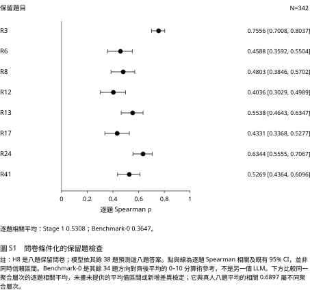
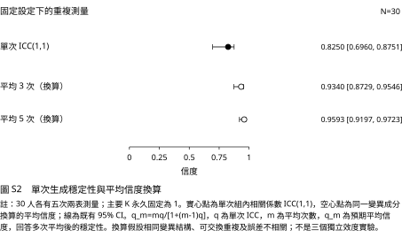
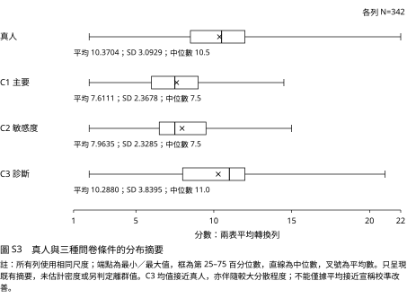
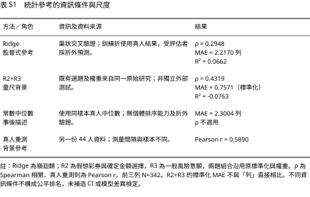
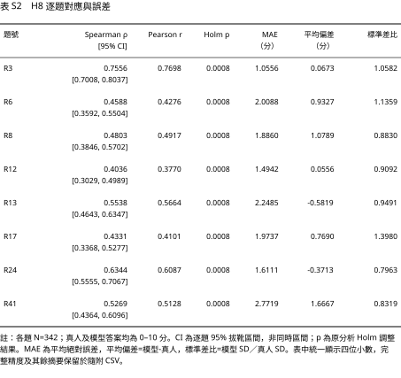
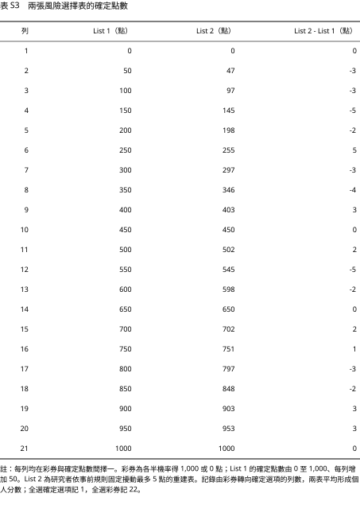
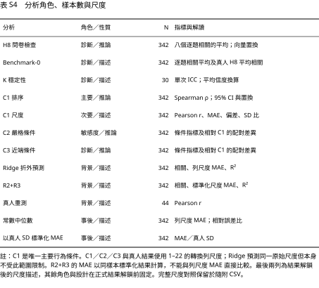
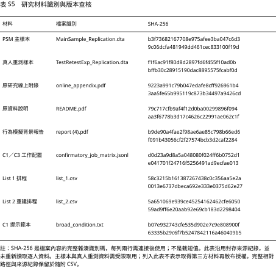

# 補充圖表

<!-- JOURNAL_SUPPLEMENT_BEGIN -->

<!-- JOURNAL_SUPPLEMENT_END -->

<!-- JOURNAL_SUPPLEMENT_BEGIN -->

<!-- JOURNAL_SUPPLEMENT_END -->

<!-- JOURNAL_SUPPLEMENT_BEGIN -->

<!-- JOURNAL_SUPPLEMENT_END -->

<!-- JOURNAL_SUPPLEMENT_BEGIN -->

<!-- JOURNAL_SUPPLEMENT_END -->

<!-- JOURNAL_SUPPLEMENT_BEGIN -->

<!-- JOURNAL_SUPPLEMENT_END -->

<!-- JOURNAL_SUPPLEMENT_BEGIN -->

<!-- JOURNAL_SUPPLEMENT_END -->

<!-- JOURNAL_SUPPLEMENT_BEGIN -->

<!-- JOURNAL_SUPPLEMENT_END -->

<!-- JOURNAL_SUPPLEMENT_BEGIN -->

<!-- JOURNAL_SUPPLEMENT_END -->

